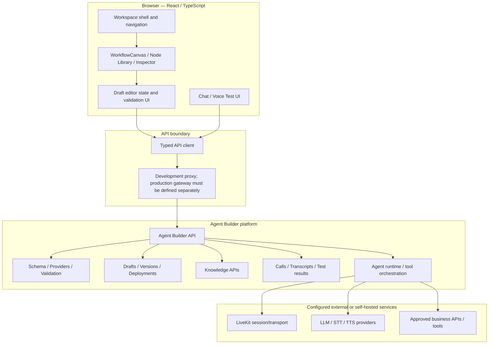
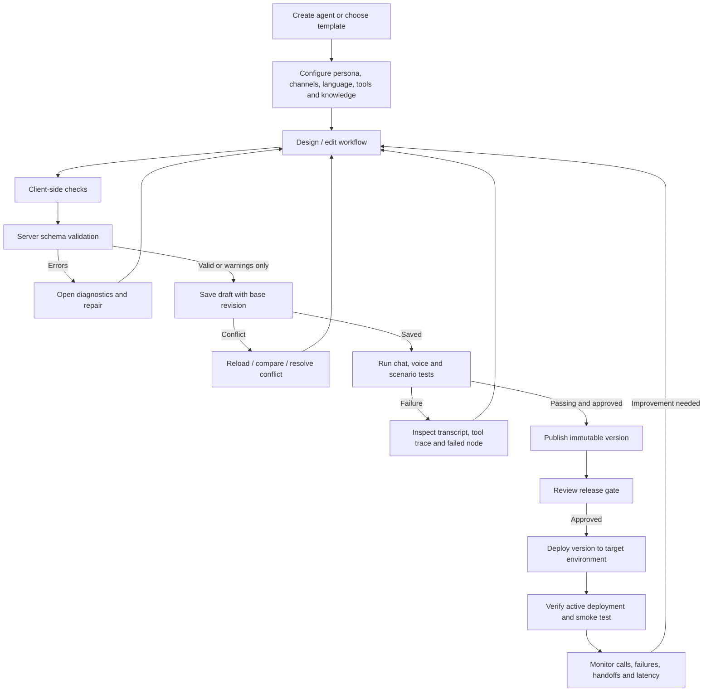
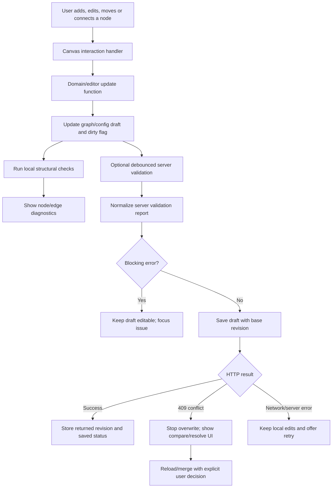
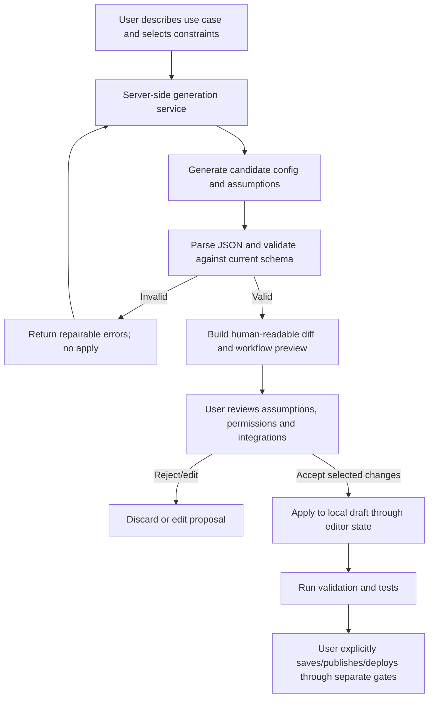
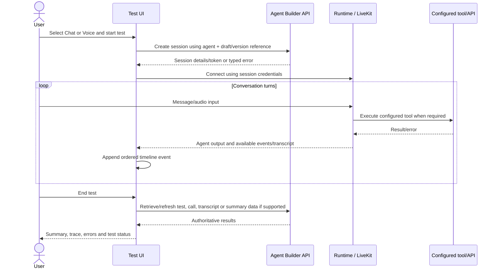
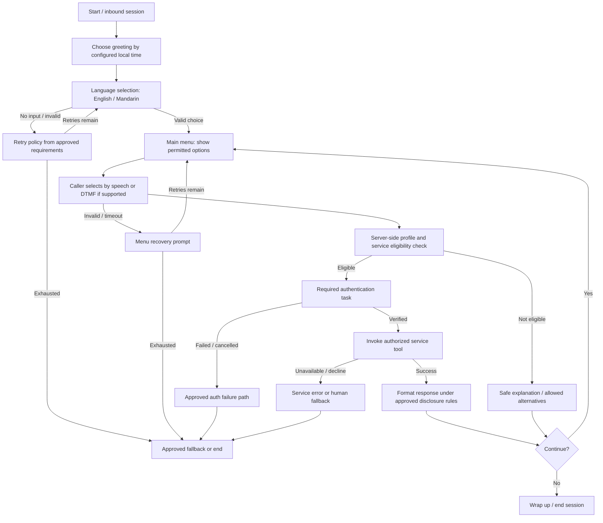
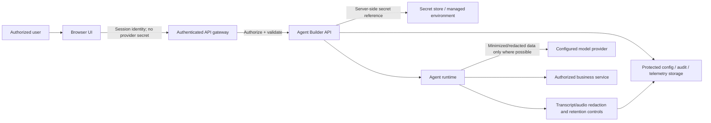

# Weave Studio
## Enterprise AI Agent Builder — Architecture & Implementation Specification

**Document ID:** WS-ARCH-001  
**Version:** 1.0  
**Prepared:** 27 October 2026  
**Status:** Proposed target architecture and delivery plan  
**Repository:** [krishn-shetty/Weave-Studio](https://github.com/krishn-shetty/Weave-Studio)  
**Audience:** Product leadership, Principal/Staff Engineers, React/TypeScript engineers, platform/backend engineers, application security, QA, UX and operations.

> **Important status distinction:** This document describes (A) the existing repository foundation, (B) proposed product/architecture improvements, and (C) open decisions requiring backend or business-owner confirmation. It is not a claim that every proposed capability is already implemented. The attached legacy IVR decks are treated as sample requirements, not as authority to change a live banking system.

---

## Document control

| Field | Value |
|---|---|
| Owner | Weave Studio product/engineering owner — assign before implementation |
| Reviewers | Frontend, backend/runtime, application security, QA, UX, operations |
| Source baseline | Public `main` repository reviewed on 27 October 2026; uploaded IVR flow decks reviewed for representative requirements |
| Change approach | Incremental, small pull requests, current API/config contract preserved |
| Approval required before production | Product owner, backend/runtime owner, security owner and service/business owner for any regulated workflow |

## Contents

1. Executive summary and decisions
2. Goals, scope and non-goals
3. Current repository baseline
4. Target product experience and UX architecture
5. Target system architecture
6. End-to-end agent lifecycle
7. Visual workflow canvas architecture
8. AI-assisted creation and change review
9. Voice/chat testing and runtime observability
10. IVR requirements mapping and reference workflow
11. API and configuration contracts
12. Application security and privacy architecture
13. Reliability, diagnostics and operations
14. Test strategy and acceptance criteria
15. Delivery roadmap and work breakdown
16. Risks, assumptions and open decisions
17. Architecture decisions and definition of done
18. References

---

# 1. Executive summary and decisions

Weave Studio should become a polished enterprise environment for designing, validating, testing, releasing and monitoring conversational AI agents. The aim is not merely to apply a new visual theme. The product must make complex agent behavior understandable, reviewable, secure and testable.

The current repository already contains much of the base architecture: React 18, TypeScript, Vite, Tailwind CSS, a workflow canvas based on `@xyflow/react`, drag-and-drop packages, structured agent configuration types, a typed API client, draft revision handling, validation, publish/deploy flows, LiveKit session support, knowledge tools, call history and lifecycle screens.

**Primary architectural recommendation:** extend the existing implementation rather than replacing it. Preserve the server-backed AgentConfig as the source of truth, use the existing React Flow canvas, keep network operations in the typed API boundary, and ensure visual, guided, detailed and JSON views round-trip through the same draft state.

## 1.1 Decisions recommended now

| ID | Decision | Rationale |
|---|---|---|
| ADR-01 | Reuse `@xyflow/react` and the existing `WorkflowCanvas` | Avoid a second graph engine, parallel state and unnecessary migration risk. |
| ADR-02 | Keep Agent Builder API schema/config authoritative | Prevent the UI from inventing a format that cannot be saved or executed. |
| ADR-03 | Treat AI output as a proposal, never an automatic release | Keep a human review gate before changing a tested agent. |
| ADR-04 | Keep draft, publish and deploy as separate lifecycle actions | Support immutable releases, audit, rollback and predictable promotion. |
| ADR-05 | Make failure paths first-class workflow objects | Real agents must handle silence, invalid input, tool failure and transfer failure. |
| ADR-06 | Surface actual runtime data only | No fake API results, transcript events, readiness status or deployment success. |
| ADR-07 | Treat IVR content as an illustrative fixture until approved | Avoid inferring account policy, security behavior or routing from a legacy diagram. |

## 1.2 Definition of success

A developer or conversation designer should be able to create an agent, visually understand its path, edit it without losing configuration, run chat/voice tests, trace a failure to a node or tool, fix the issue, validate and publish an immutable version, deploy it to a selected environment, and inspect real runtime behavior afterward.

---

# 2. Goals, scope and non-goals

## 2.1 Product goals

- Reduce the time needed to create and understand an agent.
- Provide a modern, calm, high-density canvas appropriate for enterprise workflows.
- Make branches, tool calls, agent handoffs, validation errors and failure paths explicit.
- Keep chat and voice testing inside the same agent workspace.
- Make AI assistance useful while preserving human control and traceability.
- Support draft/version/environment workflows with clear status and actionable errors.
- Provide enough observability to debug a bad answer, failed tool, unexpected transfer or timeout.
- Protect credentials, caller PII and sensitive financial information through enforced server-side controls.

## 2.2 In scope

1. Agent workspace and navigation UX.
2. Visual canvas and node inspector improvements.
3. Workflow graph validation and error navigation.
4. AI-assisted drafting, explanations and test generation (subject to a server-side capability contract).
5. Integrated Chat/Voice test experience and transcript timeline.
6. IVR example template and exception-handling test fixtures.
7. Versioning, validation and deployment usability.
8. Security, privacy, accessibility, testing and operations requirements.

## 2.3 Out of scope for the first increment

- Replacing the Agent Builder backend or runtime.
- Adding a new graph library.
- Rewriting all pages in one large change.
- Inventing new configuration fields without server schema approval.
- Implementing actual banking/account integrations from a legacy IVR diagram.
- Inferring authentication policies, entitlement checks, retry counts or transfer destinations.
- Automatically deploying AI-generated flows.
- Claiming compliance certification based on UI work alone.

## 2.4 Quality attribute priorities

| Attribute | Expected behavior |
|---|---|
| Correctness | Canvas changes serialize predictably, validate against server schema and round-trip without silent data loss. |
| Security | Authorization, secrets and sensitive operations are enforced server-side; client-side checks are usability aids only. |
| Reliability | Network failures, API validation errors and revision conflicts have explicit recovery paths. |
| Usability | Users can locate nodes, understand the active path and reach relevant settings without hunting through unrelated panels. |
| Operability | Real test traces, tool outcomes, errors and deployment state are visible and searchable. |
| Accessibility | Keyboard alternatives, focus indicators, labels, status text and reduced-motion support. |
| Maintainability | Reuse existing design tokens, hooks, typed API boundaries and focused modules. |

---

# 3. Current repository baseline

The repository reviewed is `krishn-shetty/Weave-Studio`, with `main` as the default branch at the time of review. Relevant files observed in the repository include:

| Area | Existing path | Current responsibility / use |
|---|---|---|
| Agent lifecycle | `src/pages/AgentWorkspace.tsx` | Routes Overview/Build/Test/Release/Monitor/Setup and composes stages. |
| Build stage | `src/components/agent/BuildStage.tsx` | Build workspace composition. |
| Canvas | `src/components/agent/build/WorkflowCanvas.tsx` | Existing visual workflow editor using React Flow/XYFlow. |
| Node library | `src/components/agent/build/workflow/NodeLibrary.tsx` | Workflow node catalog. |
| Inspector | `src/components/agent/build/workflow/Inspector.tsx` | Selected-node configuration. |
| Checks | `src/components/agent/build/workflow/ChecksPanel.tsx` | Workflow checks/diagnostics. |
| Blocks/styles | `src/components/agent/build/workflow/FlowBlocks.tsx`, `look.ts` | Shared block presentation and canvas look helpers. |
| Guided/detail/JSON | `src/components/agent/build/GuidedView.tsx`, `DetailedView.tsx`, `JsonView.tsx` | Alternative config editing modes. |
| Draft/lifecycle | `src/hooks/` and `src/contexts/` | Draft editor, readiness and studio state (confirm exact hook before editing). |
| API boundary | `src/api/client.ts`, `src/api/types.ts` | Typed request and API response handling. |
| Domain types | `src/types/studio.ts` | Agent, channel, tool, version and call types. |
| Test stage | `src/components/agent/TestStage.tsx` | Current draft test workflow. |
| Release stage | `src/components/agent/ReleaseStage.tsx` | Publish/deploy lifecycle. |
| Monitoring | `src/components/agent/MonitorStage.tsx`, `src/pages/Calls.tsx`, `CallDetail.tsx` | Calls, telemetry and transcripts. |
| Toolchain | `package.json` | React 18, TypeScript, Vite, Tailwind, Vitest, ESLint and quality scripts. |

The current package includes `@xyflow/react`, `@dnd-kit/core`, `@dnd-kit/sortable`, `framer-motion`, `lucide-react`, `livekit-client`, `vitest`, Tailwind CSS and TypeScript. Reuse these capabilities where they fit. Do not add a dependency without documenting why the existing stack cannot satisfy the requirement.

## 3.1 API and environment baseline

The repository README documents an `AGENT_BUILDER_URL` backend address, optional `AGENT_BUILDER_API_KEY`, an optional user attribution variable, and a development proxy that routes browser `/api` calls to the Agent Builder backend. It documents endpoints for schema, providers, bots/drafts, validation, versions, deployments, sessions, knowledge, calls/transcripts and test execution. The frontend guide describes local API docs at `/docs` and indicates file-backed backend data for its documented local setup.

**Production note:** Vite's development proxy is not a production security boundary. Production routing, identity provider/SSO, secret management, database durability, tenant isolation and audit retention must be confirmed in deployment architecture. The UI must not expose server credentials to the browser bundle.

## 3.2 Baseline evidence required before changing code

Run the existing project checks and record the result before implementation. Confirm current Git branch/status, capture current screenshots, inspect `WorkflowCanvas.tsx`, node models, inspector binding logic, draft hook, server `/schema`, and the supported node/action types. This prevents a design improvement from masking an existing limitation or introducing a behavior regression.

```bash
npm run lint
npm run typecheck
npm test
npm run build
npm run check:no-fake
npm run check
```

A baseline failure should be recorded separately from a regression introduced by the change. Do not make a broad refactor simply to make unrelated pre-existing tests pass.

---

# 4. Target product experience and UX architecture

## 4.1 Workspace information architecture

The interface should make the agent lifecycle understandable without overloading the global navigation.

- **Home:** workspace health, recent agents, recent activity and next recommended task.
- **Agents:** filterable/searchable agent registry; status, channel and environment indicators.
- **Agent workspace:** Overview, Build, Test, Release and Monitor stages.
- **Knowledge:** documents, indexes, source status and search test tools.
- **Calls:** real conversation records, transcript, audio where permitted, tool timeline and outcome.
- **Analytics:** call volume, handoff/cutoff/tool-failure trends and comparison periods where real metrics exist.
- **Library:** supported voices/providers/templates and capability information.
- **Settings:** workspace, user, theme, environment and authorized integration settings.

Do not create new navigation sections unless a real user workflow requires them. Prefer contextual tabs within the agent workspace to a growing list of independent pages.

## 4.2 Canvas-first desktop layout

```text
┌──────────────────────────────────────────────────────────────────────────────┐
│ Agent name · Draft/Saved · Validation · Undo/Redo · Test · Publish            │
├───────────────┬─────────────────────────────────────┬────────────────────────┤
│ NODE LIBRARY  │                                     │ NODE INSPECTOR         │
│ Search        │          WORKFLOW CANVAS            │ Basics                 │
│ Conversation  │   nodes · edges · minimap · zoom    │ Configuration           │
│ Logic         │                                     │ Routing / Recovery      │
│ Tools         │                                     │ Advanced / Diagnostics  │
│ Reliability   │                                     │                        │
├───────────────┴─────────────────────────────────────┴────────────────────────┤
│ Diagnostics drawer: Errors · Warnings · Unreachable nodes · Test results      │
└──────────────────────────────────────────────────────────────────────────────┘
```

**Recommended desktop sizing:** node library 240–280 px; inspector 320–380 px; canvas receives the remaining width. These are initial design targets to validate with real content and screen recordings, not hard-coded requirements. On smaller displays, side panels become drawers and must preserve canvas navigation and focus order.

## 4.3 Visual language

- Use neutral surfaces, crisp borders and strong typography hierarchy.
- Keep color restrained; use semantic colors only to signal node category/status.
- Pair status colors with icons and text—never communicate validation solely by color.
- Use one consistent icon family (`lucide-react` is already installed).
- Standardize spacing, border radii, focus rings and hover/selected states through existing design tokens.
- Keep motion short and meaningful; respect `prefers-reduced-motion`.
- Prefer inline errors and a focused inspector over large alerts for every issue.
- Avoid overuse of gradients, glow, animated backgrounds and oversized cards that reduce information density.

## 4.4 Node interaction contract

Every node should display a clear title, category/icon, short purpose, connection handles and a compact validity indicator. The selected state must be obvious but not distract from branch topology. Where the underlying schema supports it, the node menu can expose duplicate, rename, disable and delete. Delete operations must disclose connected edges that will also be removed.

Required interactions:

- Select a node and focus its inspector.
- Add a node from the library or contextual canvas action.
- Connect and disconnect supported ports/edges.
- Move nodes without accidental drag when interacting with input controls.
- Zoom, pan, fit-to-view and use the minimap.
- Undo/redo meaningful edits.
- Navigate from a diagnostic to the exact node/field.
- Understand whether a change is local, saved, conflicted or invalid.

## 4.5 Design states to cover

For every major surface, design and test: initial/loading, empty, populated, selected, hover/focus, unsaved changes, saving, saved, schema-invalid, network unavailable, unauthorized, conflict, unsupported capability and read-only/Viewer state. Avoid treating every non-success as the same generic toast.

---

# 5. Target system architecture

## 5.1 Logical architecture



**Boundary principle:** the browser edits intent and renders authoritative results; it does not become the enforcement point for protected access, secrets, financial authorization, publish/deploy permission or tool execution. Production topology, identity and persistence require confirmation from the backend/platform owner.

## 5.2 Component responsibility boundaries

| Layer | Owns | Must not own |
|---|---|---|
| Page/workspace shell | Navigation, stage selection, coarse state presentation | Ad hoc API payload construction or security decisions |
| Canvas/presentation | Node/edge interaction and view layout | A second independently editable agent configuration |
| Inspector/forms | Editing supported fields and showing field errors | Direct mutation outside the editor’s update pathway |
| Draft editor/domain state | Pending edits, dirty state, undo/redo integration, revision coordination | Secrets or hidden backend state not returned by APIs |
| API client | Typed methods, request/response parsing and normalized errors | Rendering logic or domain policy enforcement |
| Backend API | Schema validation, persistence, authorization, publishing/deployment controls | Depending on frontend validation as the only guard |
| Runtime | Conversation execution, tool calls, handoffs and event reporting | Trusting prompts alone to enforce access control |
| Observability/audit | Real traces, call history, change attribution and outcomes | Logging unrestricted sensitive payloads by default |

## 5.3 Source of truth and state ownership

- **Executable config and draft editor:** server AgentConfig is authoritative; the editor holds the local working copy, dirty flag and undo history.
- **Server revision:** concurrency token used to detect stale writes and protect against silent overwrites.
- **Published version and deployment pointer:** publication freezes a validated snapshot; each environment points to its active immutable version.
- **Canvas layout:** presentation-only metadata unless the backend explicitly models visual topology. Its storage location is open; do not persist arbitrary UI fields into executable config.
- **Test/session state:** backend-returned observations and outcomes, never implicit changes to agent configuration.

## 5.4 Logical request path

In local development, browser calls to `/api/...` are routed by the Vite proxy to `AGENT_BUILDER_URL` and can receive server-side bearer-key injection. This is a development convenience. Production must provide a deliberate authenticated API route/gateway with server-side credentials, origin/CORS controls, rate limits and observability. Never embed `AGENT_BUILDER_API_KEY` or provider credentials in `VITE_*` client variables.

---

# 6. End-to-end agent lifecycle

## 6.1 Primary workflow



## 6.2 Lifecycle state model

| State | Meaning | Allowed primary actions |
|---|---|---|
| New/unconfigured | Agent shell exists but required settings are incomplete | Configure, inspect, save draft |
| Draft dirty | Local edits are not confirmed saved | Save, validate, undo/redo, leave with guard |
| Draft saved | Server confirmed current draft revision | Edit, test, validate, publish if gate allows |
| Invalid draft | Draft has one or more blocking schema/config issues | Edit, revalidate, save where API contract allows |
| Tested | One or more real test executions exist for a draft/version reference | Inspect tests, edit, run regression tests |
| Published | Immutable version created by server | Compare versions, select deployment environment |
| Deploying/pending | Deployment request accepted but not yet confirmed active | Poll/refresh status, view logs/details |
| Active | Environment points to the specified published version | Monitor, rollback by deploying a prior immutable version |
| Failed/rolled back | Deployment failed or prior version was restored | Inspect actual error/audit history, retry only after resolution |

UI state must reflect confirmed API state. Do not infer `Published`, `Active`, or `Tested` from a button click or optimistic animation alone.

## 6.3 Save, publish and deploy are separate boundaries

- **Save draft** stores a working configuration. Follow the backend contract for whether invalid intermediate states may be saved.
- **Validate** reports schema errors, warnings, required secrets and unsupported capabilities.
- **Test** executes a draft or immutable version reference as supported by the session/test APIs.
- **Publish** freezes a validated draft into a version.
- **Deploy** points a specified environment to a published version, with explicit confirmation and audit details.
- **Rollback** is a new deployment decision pointing the environment to a previous immutable version; it is not editing the historical artifact.

---

# 7. Visual workflow canvas architecture

## 7.1 Authoring and save workflow



## 7.2 Graph to configuration mapping

The graph must be a view/editor for server-supported semantics. Before changing serialization, write down the mapping between:

1. Stable node ID and the config object/action/task/agent it represents.
2. Stable edge ID and the supported control-flow/condition/action relationship.
3. Node fields in the inspector and exact schema paths.
4. Canvas position and any layout persistence model.
5. Graph validation diagnostics and server `ValidationIssue`/`ValidationReport` results.

If the backend config does not represent arbitrary graph nodes and edges, do **not** invent a hidden conversion that loses logic. Either expose a graph only for supported constructs, introduce an approved adapter with round-trip tests, or request a backend schema/runtime change. The UI must not show an editable graph that cannot be faithfully saved and executed.

## 7.3 Node catalog and inspector contract

Proposed catalog groupings, subject to schema/runtime verification:

| Group | Concepts | Validation questions |
|---|---|---|
| Conversation | Entry/greeting, fixed speech, model response | Is this a supported action/config field? Which channels support it? |
| Input | Speech/text/DTMF collection | Does the runtime support collection for this channel? What is the timeout contract? |
| Logic | Condition, branch, state update | Are the condition operators and state fields supported by schema? |
| Knowledge | Search/query knowledge base | Is the base configured, indexed and accessible to this agent? |
| Tools | HTTP, MCP, builtin, code or task | Is the tool type/connection allowed? Are inputs and outputs validated? |
| Agent routing | Handoff to specialist | Is the target agent defined and the handoff supported by runtime? |
| Telephony | Transfer/callback, end call | Does the runtime/channel support it? Is transfer fallback configured? |
| Reliability | Timeout, retry, failure action | Are timeout and retry values explicit and within policy? |
| Observability | Log, notify, wrap-up | Is action supported and safe for the data being emitted? |

Every inspector section should support field-level validation, server-derived warnings and a link to detailed JSON/schema when appropriate. Keep normal tasks simple; show advanced fields progressively.

## 7.4 Graph validation rules

**Local structural checks** may include missing targets, disconnected edges, unreachable nodes, duplicate visual IDs, an invalid start node, missing branch destinations and obvious dead ends. Label these as client checks.

**Server validation** must remain authoritative for schema correctness, supported features, connection type matching, secret requirements and backend-enforced policies. The UI must show both sets without implying that local checks prove the agent is safe.

## 7.5 Undo/redo and concurrency

Undo/redo should record meaningful authoring operations and preserve editor consistency. It must not bypass validation, revision checks, authorization or saved-state indicators. Keyboard shortcuts must not fire while focus is in text inputs, textareas, contenteditable controls or other editors.

For a revision conflict:

1. Preserve the local draft in memory.
2. Do not blindly retry a stale write.
3. Fetch/offer the current server draft and a structured diff.
4. Let the user reload, copy out local changes or resolve supported fields.
5. Revalidate and save against the new base revision.
6. Record the resulting save attribution through the existing API behavior.

---

# 8. AI-assisted creation and change review

## 8.1 Intended interaction

Offer an optional “Describe your agent” path, but use the same agent configuration and validation model as manual editing. For example: “Create a bilingual customer-support voice agent that greets callers, identifies the request, uses the support knowledge base, transfers complex cases to a human, and handles recognition failures.”

The generative system should produce a **proposal**, not a live agent. A proposal may include a candidate config, node/branch summary, assumptions, questions for missing requirements, required integrations and suggested tests.

## 8.2 Generation workflow



## 8.3 Minimum AI feature set

**Phase A — safe assistance:** prompt/persona draft, explanation of validation errors, draft documentation, test-scenario suggestions.

**Phase B — workflow proposal:** suggested nodes and branches, missing fallback suggestions, selected-node explanation, human-readable diff and selective apply.

**Phase C — optimization:** evaluate real test and call evidence, produce a suggested improvement and regression scenarios, compare with baseline. Never use model confidence alone to promote a production change.

## 8.4 Required safeguards

- Generation runs server-side if it needs protected model credentials or enterprise data.
- Candidate output must parse and validate against the live schema.
- All assumptions and missing information must be visible to the user.
- Treat user prompts, imported documents and retrieved content as untrusted data; do not allow them to override security policy.
- Do not pass provider secrets, authentication codes, full payment card data or unnecessary customer PII to the model.
- AI tools may propose integrations but cannot invent credentials, permission grants or account access.
- Keep review and audit attribution for accepted generated changes.
- Never claim tests passed unless the actual test service ran and returned results.
- Never publish or deploy automatically from a generation request.

---

# 9. Voice/chat testing and runtime observability

## 9.1 Integrated test workspace

Provide clear **Chat** and **Voice** modes within the Test stage. Both should use the actual session/test APIs and the same draft/version semantics. Do not create a second execution engine for preview.

**Chat mode** should show turn-by-turn messages and support the channel capabilities returned by the server. **Voice mode** should expose session connectivity, microphone permissions, listening/speaking state, elapsed time, end-call action and visible session errors. If the LiveKit/runtime setup supplies transcript updates, render them in the same ordered timeline as audio activity. If not, show transcript unavailable or delayed explicitly rather than fabricating interim turns.

## 9.2 Runtime test sequence



## 9.3 Timeline event types

Use semantic timeline rows rather than dressing all events as chat bubbles:

- Caller/user message.
- Agent response.
- Listening/speaking/session-state change, only if runtime provides it.
- Tool/API call with status, duration and safe summary.
- Handoff or transfer event, if returned.
- Validation or runtime error.
- Transcript segment with timestamp when provided.
- End-of-session summary/analysis where supported.

Sensitive tool arguments and raw error bodies must be redacted or access-controlled. The UI should make it clear which values are user utterances, generated output, backend events and derived analysis.

## 9.4 Scenario testing

Each scenario should include a name, starting reference (draft/version), channel, initial state, user turns/DTMF where supported, expected route/outcome, assertions and result evidence. Prioritize stable assertions for control flow, tool selection, authentication gates, fallback path and successful completion. Avoid brittle tests that require an LLM to reproduce exactly the same wording.

---

# 10. IVR requirements mapping and reference workflow

The three uploaded *Voice Self-Service Channel for BBCSC* decks are legacy flow specifications. They provide representative use cases for the visual builder and its exception handling. They are **not** a production source of truth for an actual account service. All service IDs, prompts, authentication rules, limits, eligibility logic, hours and transfer destinations require validation by the responsible business/system owner.

## 10.1 Requirements observed in source pages

- **Page 1:** start, time-of-day greetings, English/Mandarin language selection, stored preference concept and retry behavior around language selection.
- **Page 2:** main menu categories, optional speech recognition, DTMF options, timeout/invalid-input routing, and explicit notes to include an accessibility matrix plus invalid/no-option and exception-handling flow/script content.
- **Page 3:** authentication, customer/account profile conditions and dynamic menus for account balance, incoming funds, recent activity, statements, phone PIN change and fixed deposit/loan service branches; a transfer option is also shown.
- **Pages 4–5:** balance path with single/multiple account handling, current vs available balance, successful/failed system response branches, negative/debit presentation and response-matrix dependencies.

The diagrams include legacy identifiers and abbreviations (for example service/prompt IDs and account/customer codes). These must be decoded with the source owner rather than guessed by the UI engineer.

## 10.2 Illustrative modern flow



**Important:** this diagram intentionally uses “approved policy” and “configured behavior” instead of inventing a retry count, authentication rule or transfer destination. Resolve discrepancies across deck revisions before implementing an operational flow. The source materials contain variant content; treat the approved signed-off version as authoritative.

## 10.3 Mapping legacy IVR concepts to builder concepts

| Legacy concept | Candidate UI representation | Validation/confirmation required |
|---|---|---|
| Time-based greeting | Entry + time condition + message | Time zone, exact intervals, prompt identifiers |
| English/Mandarin choice | Choice/condition with language branches | Supported ASR/DTMF behavior, retries, default language |
| Stored preferred language | Profile/state update tool | Authoritative profile/CMM integration and consent policy |
| Main menu with numbered options | Menu/choice node with DTMF and spoken-intent variants | Correct keys, spoken labels, which channels support input modes |
| Dynamic service visibility | Server-backed eligibility result / condition | Profile source, permissions, rule ownership and freshness |
| Authentication | Explicit authentication task/gate | Approved policy; no credentials/OTP should be collected outside approved flows |
| Account balance request | Protected service/API tool | Actual endpoint, access policy, response contract and safe formatting |
| Incoming funds/activity/statements | Distinct service/tool nodes or supported tasks | Tool availability and authorization matrix |
| Timeout/invalid input | Retry/fallback edges | Retry count, exact timeout, prompt and exhausted behavior |
| Manager/agent transfer | Transfer/handoff node | Queue, business hours, caller context and transfer-failure path |
| Current/available balance branch | Condition + response formatting | Source fields, negative/debit handling and currency formatting |
| End call / return to menu | Wrap-up/end/return action | Supported runtime behavior and allowed transitions |

## 10.4 Service accessibility matrix

Keep access rules explicit and reviewable, but never treat a client-side table as authorization enforcement. The backend must resolve protected access and return only permitted service options.

| Field | Required specification |
|---|---|
| Service name and stable ID | Approved public/internal identifier and description |
| Channel | Voice/phone, web voice, web chat or other supported channel |
| Language | Required and allowed languages |
| Customer/profile segment | Relevant profile condition; avoid exposing sensitive values to the UI unnecessarily |
| Authentication | Approved status/policy reference and freshness requirement |
| Account/entitlement | Required account type and access scope |
| DTMF mapping | Exact key or “not applicable” |
| Speech intent/examples | Supported phrases/intents and ASR failure behavior |
| Business-hour requirement | Hours/time zone, if applicable |
| Success behavior | Tool, allowed output fields and disclosure rule |
| Failure/retry behavior | Timeout, invalid input, API error, decline and retry exhaustion |
| Human fallback | Approved destination and unavailable behavior |
| Source and approval | Source document/version, business owner, security owner and approval date |

## 10.5 Required exception catalog

Every applicable menu and transaction path must specify behavior for:

- No input/timeout.
- Invalid DTMF selection or unrecognized speech.
- ASR/STT not configured, unavailable or returning no result.
- User interruption while a prompt is playing.
- Authentication failure, cancellation, timeout or lockout.
- No eligible account/service or insufficient permission.
- Backend timeout, network failure, malformed response, service decline or partial result.
- Transfer unavailable, outside approved hours or queue failure.
- Repeated errors and retry exhaustion.
- Caller requests a human.
- User returns to menu or ends the interaction.

Each exception should have an owner-approved script, retry policy, state transition and a test case. If the requirement is unknown, document it as an open decision—do not silently use a developer’s guess.

---

# 11. API and configuration contracts

## 11.1 Typed API client

Use the existing `src/api/client.ts` and `src/api/types.ts` boundary. UI components should call typed hooks/domain operations rather than building ad hoc paths and request bodies independently. Preserve normalized API error categories and abort/cancellation behavior already present in the client.

The repository README/client docs describe the following endpoint families; verify each against the live backend `/schema` and `/docs` before depending on it:

| Family | Representative operation | Purpose |
|---|---|---|
| System | `GET /health`, `GET /schema`, `GET /providers` | Health, configuration contract and provider capability discovery |
| Agent | `GET/POST /bots` | List and create agents |
| Draft | `GET/PUT /bots/{id}/draft` | Load/save working config with revision semantics |
| Validation | `POST /validate` | Server schema/config validation |
| Versions | `POST /bots/{id}/publish`, version/diff reads | Immutable published version creation and comparison |
| Deployment | `POST /bots/{id}/deploy`, deployment reads | Promote an immutable version to an environment |
| Session/testing | `POST /bots/{id}/sessions`, tests endpoints | Real chat/voice session and scenario execution |
| Knowledge | knowledge-base/file/search/build/status operations | Knowledge management and retrieval testing |
| Telemetry | calls, call detail, transcript | Call history and trace inspection |

## 11.2 Configuration rules

- Read the server schema instead of assuming all provider fields are supported.
- Do not delete unknown/unmodeled fields when editing known fields; preserve them where the current editor contract supports safe preservation.
- Do not push canvas layout fields into the executable config unless the server schema explicitly supports them.
- Objects and arrays must serialize according to the backend schema’s semantics—never assume a visual edge can be converted into a valid action without proof.
- Use stable IDs. Avoid deriving IDs from mutable labels or list indexes.
- Maintain a mapping from API validation paths to inspector fields and visual nodes.
- On save, use the correct base revision and record the returned revision/saved metadata.

## 11.3 Proposed canvas-layout artifact (only if needed)

If layout is not part of the server config, a separate presentation artifact may be appropriate, subject to product/platform approval:

```ts
type CanvasNodeLayout = { nodeId: string; x: number; y: number; collapsed?: boolean };
type CanvasLayoutDocument = { schemaVersion: 1; agentId: string; layout: CanvasNodeLayout[]; updatedAt: string };
```

This is a proposed UI model, not an existing API contract. Decide whether to store it via supported metadata, a dedicated endpoint or local state. Include migration/versioning rules before persisting it for users.

---

# 12. Application security and privacy architecture

## 12.1 Security principles

1. Enforce authorization in the backend; client-side controls improve UX but do not protect data.
2. Keep bearer keys, LLM/STT/TTS credentials, database credentials and integration secrets server-side.
3. Validate all inputs server-side, including model-generated JSON, imported configs, tool arguments and user-supplied identifiers.
4. Apply least privilege to tools, environments and customer data.
5. Separate draft editing permission, publish permission and production deploy permission.
6. Use secure transport and protected storage for transcripts/audio/configuration in deployed environments.
7. Redact or minimize sensitive data in logs, summaries, prompts and UI timelines.
8. Record audit events for create/save/publish/deploy/rollback and permission-sensitive changes.
9. Keep prompt-level instructions separate from code-enforced authorization and guardrails.
10. Do not claim regulatory compliance without independent controls verification and formal assessment.

## 12.2 Trust boundaries and sensitive data flow



In production, define and test the gateway/identity boundary, secret provider, encryption, log retention and redaction implementation. The current frontend repository is not proof that these backend controls exist.

## 12.3 Threat model and controls

| Threat | Example | Required controls |
|---|---|---|
| Credential exposure | API/provider key in browser code or logs | Server-side secret store/environment; secret references only in config; scan bundles and logs |
| Broken access control | Viewer can deploy or access another team’s agent | Backend RBAC and object-level authorization on every sensitive API operation; negative tests |
| Stale draft overwrite | Concurrent editor replaces newer changes | Revision/ETag-style conflict handling; no blind stale retries; explicit compare/resolve UI |
| Prompt injection | User/document content attempts to override system policy | Treat data as untrusted; enforce security-sensitive checks in code; constrain tool permissions |
| SSRF/tool abuse | Configured HTTP tool calls internal or privileged endpoints | Backend allowlists/egress policy, URL validation, credential scoping, timeouts and response size limits |
| Sensitive-data leakage | Account identifiers or personal data in transcript/logs | Minimize, redact, access control, retention and audit; avoid logging raw payloads by default |
| Unsafe generated config | AI creates privileged tool or omits security gate | Schema validation, policy lint, diff/review, required approvals and test gate |
| Stored XSS/content injection | Imported prompt or transcript renders as HTML | Escape untrusted content, do not inject raw HTML, validate file imports |
| Supply-chain risk | Dependency compromise or vulnerable package | Lockfile review, automated audit policy, pinned compatible versions and CI checks |
| Untrusted export/import | Malicious or oversized configuration file | Type/size limits, parse-only import, schema validation and clear preview before apply |

## 12.4 Data handling requirements

- Classify configuration, prompts, call transcripts, audio, identity data and secrets separately.
- Do not return full authentication factors or payment card data in ordinary logs, summaries or AI prompts.
- Apply least-privilege access to audio and transcript review, with audit attribution.
- Define retention per data class and legal/business requirement; do not invent a universal retention value.
- Keep environment-specific secrets out of draft exports and UI JSON.
- Use safe summaries for tool activity rather than exposing raw request/response bodies by default.
- Make transcript/audio retention and deletion behavior visible to admins where supported.
- Define incident response for compromised credentials, sensitive data exposure and unauthorized deployment.

## 12.5 Security release gates

Before a sensitive or production agent is deployed, verify backend-enforced authorization, required server-side secrets, tool allowlists, redaction policy, transfer behavior, environment selection, audit trail, rollback route and approval ownership. A UI readiness checklist alone is not evidence of enforcement.

---

# 13. Reliability, diagnostics and operations

## 13.1 Error model

The current typed API client classifies failures including network, auth, not found, conflict, invalid request, unavailable and server error. Preserve those distinctions in UX. Each failure should communicate:

- What action failed.
- Whether local work is preserved.
- Whether the action may be retried safely.
- What the user should inspect or do next.
- A correlation/request ID when the backend provides one.

Do not retry mutating operations blindly. The client’s limited retry behavior for idempotent GET calls is appropriate as a design pattern; keep retries aligned with the API contract.

## 13.2 Required diagnostics

- Unreachable nodes or missing destinations.
- Required property missing or invalid.
- Unsupported provider/channel combination.
- Missing server-side secret or connection.
- Missing error/retry/handoff fallback where required by policy.
- Tool/action cannot be represented by the current runtime/schema.
- Config changed since the last validation/test.
- Save conflict or stale server revision.
- Test path diverged from expected branch.
- Runtime/session unavailable or transcript stream unavailable.

Each diagnostic should contain severity, concise description, exact config path/node where possible, a recommended next step and a “focus issue” action. Clearly label local heuristic checks versus server-authoritative results.

## 13.3 Observability events

Recommended audit/telemetry events include agent created, draft saved, validation executed, version published, deployment requested/active/failed, rollback, test started/completed, session started/ended, tool success/failure, handoff/transfer outcome and guardrail violation. Use real backend event models; do not add a UI-only “successful deployment” event if the deployment API did not confirm success.

## 13.4 Operational dashboards

Use metrics backed by real data, when available:

- Session/call count and success/failure outcome.
- Handoff and cutoff rates.
- Tool failure count and latency.
- Session setup failures and provider availability.
- Scenario pass rate by agent version.
- Deployment status and version drift by environment.
- Validation errors grouped by config path/node type.
- Transcript/audio redaction or processing failures.

Define metric aggregation, sampling, retention and tenant filtering with the platform owner before production use.

---

# 14. Test strategy and acceptance criteria

## 14.1 Test pyramid

1. **Unit tests:** node types, serialization helpers, field validation, reducers, error mapping and condition utilities.
2. **Component tests:** node selection, inspector editing, add/delete/connect, diagnostics navigation and keyboard behavior.
3. **Contract tests:** client methods against server schema and representative API responses.
4. **Round-trip tests:** load config → edit canvas → serialize → save/reload → equivalent executable configuration.
5. **Integration tests:** real draft save, validation, session creation, tool traces, publish and deployment in a non-production environment.
6. **Regression scenarios:** IVR happy paths, invalid input, silence, authentication failure, service unavailable and transfer failure.
7. **Security tests:** role enforcement, secret exclusion, object-level access, malicious imports and unsafe tool/URL rejection.
8. **Accessibility checks:** keyboard traversal, focus, status announcements, reduced motion and responsive inspector access.

## 14.2 Minimum acceptance criteria

| ID | Given / when | Expected result |
|---|---|---|
| AC-01 | Existing agent loads or user edits a node | Supported config is preserved; canvas and shared draft stay in sync; no silent field loss. |
| AC-02 | User switches canvas/guided/detailed/JSON views | Each view represents the same draft. |
| AC-03 | Server validation returns an error | The issue is actionable and focuses the mapped node/field where possible. |
| AC-04 | Save succeeds or returns a revision conflict | Success stores returned revision; conflict never blindly overwrites and preserves recoverable edits. |
| AC-05 | Session/provider API is unavailable or transcript is delayed | UI shows the real unavailable/delayed state; it never fabricates a session or transcript. |
| AC-06 | Tool, invalid-input or timeout scenario runs | Actual route/outcome is recorded, including the approved IVR recovery branch. |
| AC-07 | Publish validation fails | Release gate remains closed under the backend contract. |
| AC-08 | User deploys or rolls back a version | Backend enforces role/approval; UI shows only confirmed deployment status and audit details. |
| AC-09 | AI proposes a workflow | Assumptions and diff are reviewable; output is schema-validated; there is no auto-publish/deploy. |
| AC-10 | Viewer or sensitive trace is involved | Forbidden mutations/access are rejected server-side; sensitive payloads follow redaction/access policy. |

## 14.3 Change verification commands

```bash
npm run lint
npm run typecheck
npm test
npm run build
npm run check:no-fake
npm run check
```

Use the project’s supported Node/npm version in CI and local environments. Record environment failures separately from feature regressions. Review the final diff for duplicate components, dead CSS, abandoned feature paths, untracked files and unintended config changes.

---

# 15. Delivery roadmap and work breakdown

## Phase 0 — Baseline and discovery

**Tasks:** capture branch/status; run checks; inventory canvas/inspector/draft state; inspect runtime `/schema` and `/docs`; define current and missing behavior; agree on the source-of-truth mapping; collect screenshots and key user journeys.

**Exit gate:** no code changes begin until the current canvas serialization and save/revision lifecycle are understood.

## Phase 1 — Modernize the existing canvas UI

**Tasks:** refine hierarchy, spacing, node design, toolbar, inspector sections, empty states, status indicators, keyboard focus and responsive panels; reuse current tokens and icons; preserve existing features and API integration.

**Output:** focused UI pull request with before/after screenshots and passing regression checks.

**Exit gate:** existing flow can still be edited, saved, validated, loaded and published under current supported behavior.

## Phase 2 — Flow correctness and exception handling

**Tasks:** verify all node types against schema; improve branch labels and structural checks; connect diagnostics to fields/nodes; confirm undo/redo and delete/reconnect semantics; test serialization round trips; model timeout, invalid input, tool errors and handoff failures where supported.

**Output:** documented node-to-config map, test fixtures and diagnostics.

**Exit gate:** supported sample flow survives save/reload with equivalent semantics and exposes unresolved branches.

## Phase 3 — Chat/Voice test UX

**Tasks:** unify transcript/timeline design; improve session status and errors; render tool/handoff events returned by runtime; show summary/transcript availability; add repeatable scenarios.

**Output:** end-to-end test flow with real backend results and useful trace evidence.

**Exit gate:** an engineer can reproduce a failed scenario and identify the failed node/tool/edge or API contract.

## Phase 4 — AI-assisted authoring

**Tasks:** define generation API/schema; generate candidate config and assumptions server-side; validate; present diff; support selective application; create scenario recommendations; audit accepted changes.

**Output:** proposed config workflow that never bypasses human review.

**Exit gate:** generated config validates, saves, reloads, tests and remains subject to normal publish/deploy controls.

## Phase 5 — Enterprise hardening

**Tasks:** verify identity/SSO and backend RBAC; confirm secret store and production gateway; implement/verify audit and redaction; define retention; exercise rollback; add security and accessibility checks to CI; validate capacity and runtime metrics.

**Output:** production readiness evidence pack owned by platform/security teams.

**Exit gate:** signed approval from product, backend/runtime, security and operations/business owner as applicable.

## Suggested pull-request sequence

1. `docs: baseline, architecture and acceptance criteria`
2. `ui: modernize current workflow canvas and inspector`
3. `test/fix: graph-to-config round trips, diagnostics and IVR fixtures`
4. `feat: unify Chat/Voice test timeline; add reviewed AI proposals only after schema/API approval`

Keep PRs small and independently testable; separate UI polish from schema/runtime changes.

---

# 16. Risks, assumptions and open decisions

## 16.1 Risks

| Risk | Impact | Mitigation / owner |
|---|---|---|
| Canvas graph does not map fully to AgentConfig | Visual edits may lose or misrepresent executable behavior | Backend/runtime + frontend: schema mapping and round-trip test before feature work |
| Layout metadata has no persistence contract | Node positions may reset or leak into executable config | Product/platform: decide separate artifact or approved metadata before shipping |
| AI generation endpoint does not exist | UI could be tempted to fake generated results | Backend/platform: define endpoint and schema first; otherwise ship only prompt drafting explicitly labeled local/manual |
| Live transcript stream is not supported in all modes | UI may falsely imply real-time transcription | Runtime owner: capability check and explicit delayed/unavailable state |
| Legacy IVR docs contain conflicting revisions/abbreviations | Incorrect authentication, retries or routing could be implemented | Business owner: approve one authoritative flow and accessibility matrix |
| Existing dev proxy mistaken for production gateway | Credentials or auth assumptions may be unsafe | Platform/security: document production ingress and identity boundary |
| Large UI refactor introduces regressions | Existing save/publish/monitor behavior breaks | Tech lead: incremental PRs, full checks and screenshots |
| Sensitive transcript/log data displayed too broadly | Privacy/security incident | Security/data owner: RBAC, redaction, retention and audit testing |

## 16.2 Open decisions

- What exact AgentConfig fields encode each workflow node and edge?
- Are there graph layouts or workflows that are not represented by the current agent config schema?
- Where should visual layout metadata live, and who owns its retention/versioning?
- Which node types and condition operators are supported by the live runtime?
- Which channels support speech recognition, DTMF, streaming transcript and transfer?
- What production gateway, SSO/identity, secret store, audit store and durable storage are deployed?
- Who may publish and deploy to production? Is an additional approval required?
- What are the approved retry counts, timeout values, language fallback and transfer destinations for the IVR example?
- Which transcript/audio fields may be passed to LLMs and which require redaction?
- What retention, deletion, export and audit requirements apply to call recordings?

Resolve questions before implementation if they change the data contract or security model. For isolated UI decisions, proceed with accessible defaults and document the choice.

---

# 17. Architecture decisions and definition of done

## 17.1 Architecture decision records

### ADR-01: Extend the existing canvas

**Status:** Recommended.  
**Decision:** Improve `WorkflowCanvas.tsx` and modules under `src/components/agent/build/workflow/`; do not implement a parallel builder.  
**Consequences:** Existing graph semantics must be understood; targeted refactors are preferred over rewrite.

### ADR-02: AgentConfig remains authoritative

**Status:** Recommended.  
**Decision:** The canvas is a visual editor over server-supported configuration.  
**Consequences:** Any unsupported graph concept requires a schema/runtime change, not a frontend-only payload invention.

### ADR-03: AI proposals require review

**Status:** Recommended.  
**Decision:** AI generation returns a validated proposal and diff; user accepts changes. Publish and deploy remain separate.  
**Consequences:** Generation endpoint, schema validation and audit trail are prerequisites.

### ADR-04: Security enforcement is backend-owned

**Status:** Required.  
**Decision:** UI validation and RBAC visibility do not replace server authorization, input validation or secret controls.  
**Consequences:** Backend authorization and negative tests are release prerequisites for protected operations.

### ADR-05: IVR example is non-production until approved

**Status:** Required.  
**Decision:** Legacy decks seed a test fixture and discovery checklist only.  
**Consequences:** Approved scripts and access matrix must be obtained before any real financial integration is connected.

## 17.2 Definition of done

A change is complete when:

- It extends the current architecture without duplicating source of truth.
- It preserves existing agent lifecycle operations and route/API contracts.
- Every edit path maps to the actual schema and survives save/reload tests.
- API and validation failures are represented honestly with recoverable local state.
- Server-side authorization and secret requirements are not weakened.
- Accessibility, loading, empty, conflict and error states are covered.
- AI-generated changes are visible, validated, reviewable and never released automatically.
- Tests and full quality checks pass, or blockers and unrelated baseline failures are recorded.
- Documentation and screenshots match the implementation that actually shipped.

---

# 18. References

## Repository documentation

- Repository: https://github.com/krishn-shetty/Weave-Studio
- README: https://github.com/krishn-shetty/Weave-Studio/blob/main/README.md
- Frontend guide: https://github.com/krishn-shetty/Weave-Studio/blob/main/docs/FRONTEND_GUIDE-1-1.md
- UI review: https://github.com/krishn-shetty/Weave-Studio/blob/main/docs/UI_REVIEW-1-2.md
- Agent config guide: https://github.com/krishn-shetty/Weave-Studio/blob/main/docs/agent-config-guide-1.md

## Framework/runtime references

- React Flow / XYFlow: https://reactflow.dev/
- LiveKit documentation: https://docs.livekit.io/
- OWASP Application Security Verification Standard: https://owasp.org/www-project-application-security-verification-standard/
- OWASP API Security Top 10: https://owasp.org/www-project-api-security/

## Supplied business reference material

- *Voice Self-Service Channel for BBCSC*, uploaded deck (48 pages): greeting/language and main menu at pages 1–2; authentication/service menu at page 3; account balance branching at pages 4–5.
- Revision copy of the *Voice Self-Service Channel for BBCSC* deck (48 pages): cross-check against the first deck before using as authoritative policy.
- *SGBB-MYCFS & BB — IVR Call Flows*, uploaded deck (56 pages): alternate/revised flow, to be reconciled with the source owner.

---

## Appendix A — Claude Code implementation prompt

Use the task below as a controlled first implementation instruction. Do not ask the coding agent to redesign and refactor the whole platform in one pass.

> In `krishn-shetty/Weave-Studio`, begin audit-only: report branch/status and inspect the current canvas, inspector, diagnostics, draft hook, AgentConfig types, API client and live schema. Explain the canvas-to-config save/validation/reload path before editing.
>
> Implement **Phase 1 only**: modernize the existing canvas and inspector with React, TypeScript, Tailwind and `@xyflow/react`. Do not add a second graph library, parallel config model, mock API, fake success state or unsupported schema fields. Reuse tokens/components and remove superseded code instead of layering duplicates.
>
> List intended files first. Preserve node edits, validation, save/conflict handling, undo/redo and canvas/guided/detailed/JSON parity. Add focused tests and run `npm run check`; separate new regressions from baseline failures. Do not publish or deploy. Document unsupported runtime/schema behavior; treat IVR decks as non-production until owners approve the rules.

## Appendix B — Minimum PR review checklist

- [ ] No new graph engine or duplicate config state.
- [ ] Files changed are narrowly scoped and documented.
- [ ] No API credentials or provider secrets in client code/config export.
- [ ] Draft revision/conflict and unsaved-change guards preserved.
- [ ] Validation errors map to actionable field/node locations.
- [ ] Visual/guided/detailed/JSON modes stay consistent.
- [ ] New node/action semantics are confirmed in server schema.
- [ ] Voice/chat status and transcript display use real backend/session events.
- [ ] AI-generated config is reviewable and schema-validated.
- [ ] Error, loading, empty, unsupported and read-only states tested.
- [ ] Keyboard navigation/focus/reduced-motion are considered.
- [ ] Unit/contract/round-trip tests are added where applicable.
- [ ] `npm run check` passes or baseline blockers are explicitly recorded.
- [ ] No production publish/deploy or sensitive integration was performed as part of UI work.
